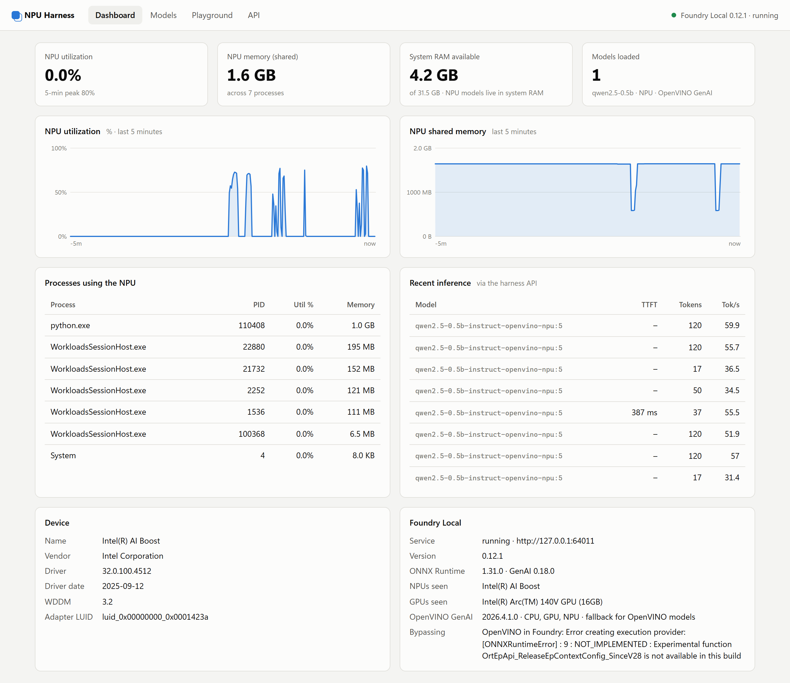
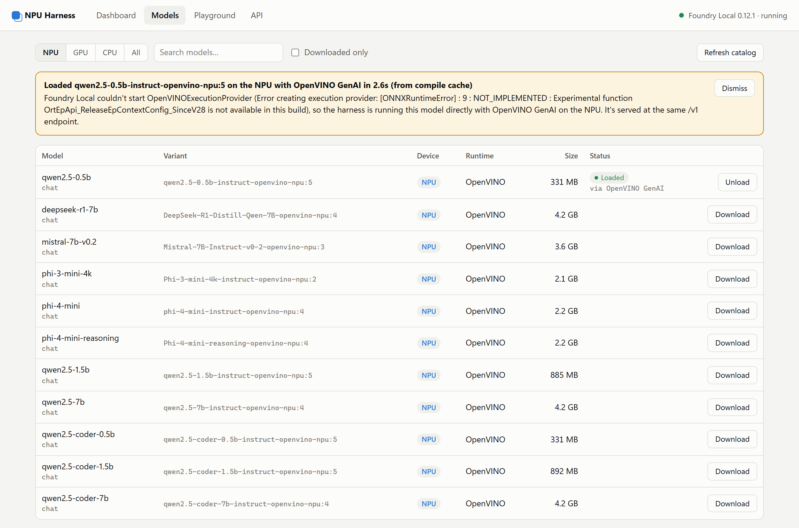
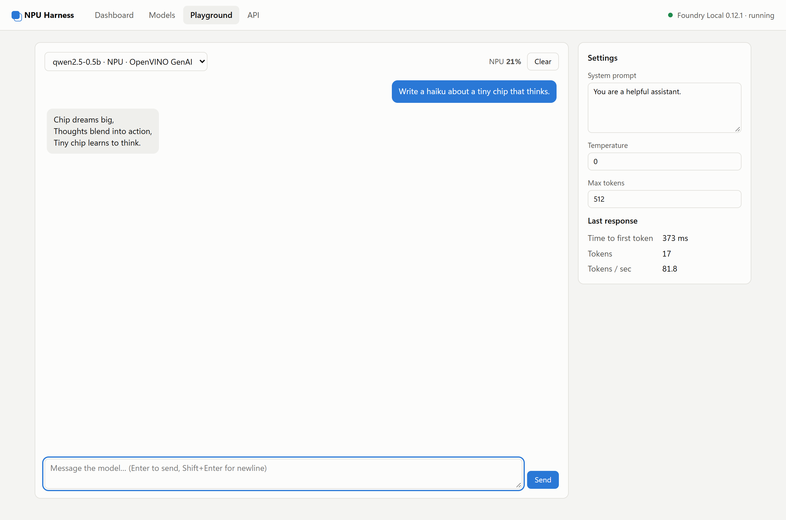
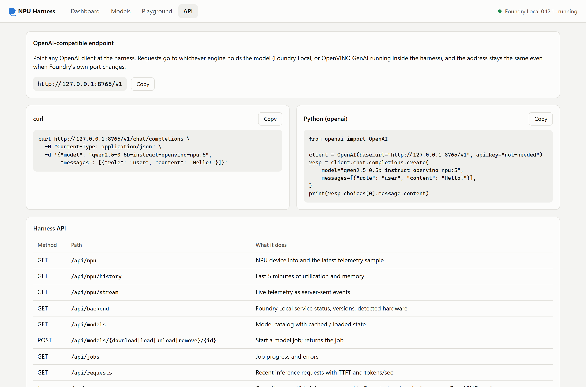
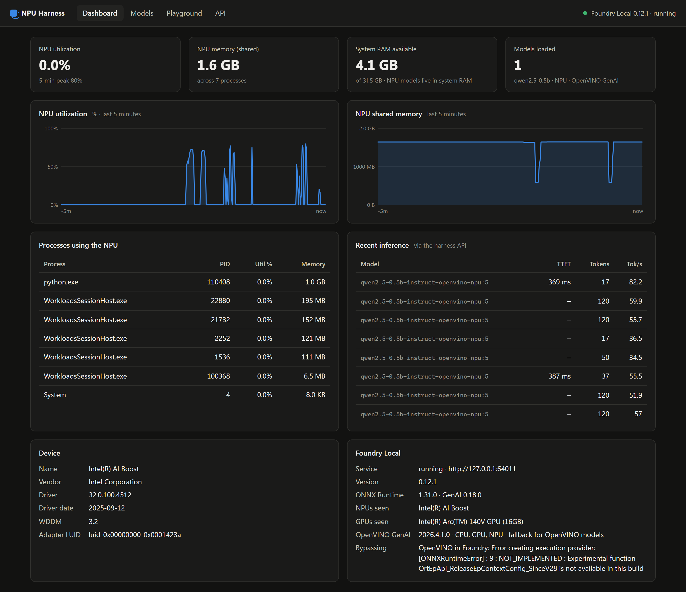

# NPU Harness

**See what your PC's NPU is doing, find models that run on it, and call them over an OpenAI-compatible API.**

NPU Harness is a local web dashboard and model manager for the neural processing unit in Copilot+ and
"AI PC" laptops. It's built on [Microsoft Foundry Local](https://github.com/microsoft/Foundry-Local) and adds
the parts Foundry doesn't have: live NPU telemetry, a visual model manager, a chat playground, plain-English
explanations when something breaks, and a fallback that runs Intel NPU models directly with OpenVINO when
Foundry's own runtime can't.



## Features

| | |
|---|---|
| **Live NPU telemetry** | Utilization, NPU memory, which processes are using the NPU, system RAM headroom, driver details. Read from the same Windows performance counters Task Manager uses; no admin rights needed. |
| **Model manager** | Foundry Local's catalog filtered to NPU builds (or GPU / CPU). Download, load, unload and delete as background jobs. |
| **Failures explained** | When a load fails, the harness pulls the real cause out of Foundry's logs and says what to do about it, instead of "internal error". |
| **OpenVINO fallback** | If Foundry can't start an Intel NPU/GPU model, the harness runs the same downloaded files directly with OpenVINO GenAI. Compiled models are cached, so later loads take seconds. |
| **Playground** | Streaming chat with any loaded model, showing time to first token and tokens/sec. |
| **Stable OpenAI API** | `http://127.0.0.1:8765/v1` works with any OpenAI client and stays put when Foundry's own port changes. Every request's latency and throughput shows on the dashboard. |

<table>
  <tr>
    <td></td>
    <td></td>
  </tr>
  <tr>
    <td align="center"><b>Models</b>: NPU builds, loaded here via the OpenVINO fallback</td>
    <td align="center"><b>Playground</b>: chat on the NPU with live stats</td>
  </tr>
  <tr>
    <td></td>
    <td></td>
  </tr>
  <tr>
    <td align="center"><b>API</b>: copy-paste client snippets</td>
    <td align="center"><b>Dark mode</b> follows your system setting</td>
  </tr>
</table>

## Requirements

- **Windows 11** on a PC with an NPU: Intel Core Ultra, AMD Ryzen AI or Snapdragon X. Developed and tested on an
  Intel Core Ultra 200V (Lunar Lake); other NPUs should work for telemetry and Foundry-served models but are untested.
- **[uv](https://docs.astral.sh/uv/)** (it installs the right Python for you), or Python 3.12–3.13
- **Foundry Local**

  ```bash
  winget install Microsoft.FoundryLocal
  ```

## Quick start

```bash
git clone https://github.com/TravisHunting/NPU-Inference-Wrapper.git
cd NPU-Inference-Wrapper
uv run npu-harness --open
```

The dashboard opens at http://127.0.0.1:8765. Then:

1. **Models** tab → **NPU** → **Download** a small model such as `qwen2.5-0.5b` (331 MB) → **Load**.
   The first load on an NPU compiles the model, which can take a minute or more; later loads come from cache.
2. **Playground** tab → say hello. Watch the NPU utilization number next to the model picker.
3. Call it from your own code:

   ```python
   from openai import OpenAI

   client = OpenAI(base_url="http://127.0.0.1:8765/v1", api_key="not-needed")
   resp = client.chat.completions.create(
       model="qwen2.5-0.5b-instruct-openvino-npu:5",
       messages=[{"role": "user", "content": "Hello!"}],
   )
   print(resp.choices[0].message.content)
   ```

### Command-line options

```
npu-harness [--host HOST] [--port PORT] [--open]
```

| Option | Default | |
|---|---|---|
| `--host` | `127.0.0.1` | Interface to bind. The API has no authentication, so keep it on localhost unless you trust your network. |
| `--port` | `8765` | |
| `--open` | off | Open the dashboard in your browser. |

The dashboard tabs are linkable: `/#dashboard`, `/#models`, `/#playground`, `/#api`.

## API

### OpenAI-compatible

Everything under `/v1/*` (chat completions, completions, models, …) is OpenAI-compatible. Requests go to
whichever engine holds the model: Foundry Local, or OpenVINO GenAI running inside the harness. Streaming
(`"stream": true`) and `stream_options.include_usage` are supported on both.

### Harness API

| Method | Path | |
|---|---|---|
| GET | `/api/npu` | NPU device info and the latest telemetry sample |
| GET | `/api/npu/history` | Last 5 minutes of utilization and memory |
| GET | `/api/npu/stream` | Live telemetry as server-sent events |
| GET | `/api/backend` | Foundry Local status and versions, detected hardware, OpenVINO status |
| GET | `/api/backend/logs?lines=100` | Recent Foundry daemon log lines |
| POST | `/api/backend/start` | Start the Foundry Local service |
| GET | `/api/models?refresh=false` | Model catalog with downloaded / loaded state and which engine runs it |
| POST | `/api/models/{download\|load\|unload\|remove}/{id}` | Start a model job; returns the job |
| GET | `/api/jobs` | Job state, results, notices and errors |
| GET | `/api/requests` | Recent inference requests with time to first token and tokens/sec |

Interactive OpenAPI docs are at http://127.0.0.1:8765/docs.

## Where things live

| What | Where |
|---|---|
| Downloaded models (Foundry's cache) | `%USERPROFILE%\.foundry\cache\models` (`foundry cache location`) |
| OpenVINO staging (hard links, no copies) | `%LOCALAPPDATA%\NPU-Harness\openvino\models` |
| OpenVINO compiled-model cache | `%LOCALAPPDATA%\NPU-Harness\openvino\compiled` |

Deleting a model from the Models tab removes it from Foundry's cache and the staging folder. The compiled
cache can be deleted at any time; models just compile again on their next load.

## Troubleshooting

**"Foundry Local couldn't start OpenVINOExecutionProvider … OrtEpApi_ReleaseEpContextConfig_SinceV28 is not
available in this build"**

Foundry Local runs Intel models through an OpenVINO plugin ("execution provider") that Windows installs and
updates separately from Foundry. When the two are out of step, Foundry can't load any OpenVINO model. The
harness works around it automatically with the OpenVINO fallback. The proper fix is a Windows Update and/or
`winget upgrade Microsoft.FoundryLocal`.

**The first NPU load takes a long time.** NPUs compile each model for a fixed prompt length (Foundry's models
use 4096 tokens). Expect a minute or more for the first load of a model; later loads take a few seconds from cache.

**"Prompt is N tokens; this NPU model was compiled for at most 4096."** NPU models have a fixed context window;
start a new conversation or shorten the prompt.

**Some processes I don't recognise are using the NPU.** `WorkloadsSessionHost.exe` is the Windows host for its
built-in on-device AI features. `python.exe` is the harness when it runs a model with OpenVINO.

**No NPU detected.** Check Device Manager → *Neural processors* (or *System devices*), and install your vendor's
latest NPU driver.

**What about temperature, power and clock speed?** Windows and the NPU vendors don't expose them, so the
dashboard can't show them.

## Documentation

- [Architecture](docs/ARCHITECTURE.md): how telemetry, the backends, the fallback and the proxy work
- [Roadmap](docs/ROADMAP.md): what's done and what's next

## Development

```bash
uv sync                    # install dependencies
uv run npu-harness         # run the server (restart it after Python changes; static files reload on refresh)
```

The frontend is plain HTML, CSS and JavaScript in `src/npu_harness/static/`, with no build step.
To refresh the README screenshots, run the harness and then
`uv run --with playwright python scripts/capture_screenshots.py docs/screenshots`.
